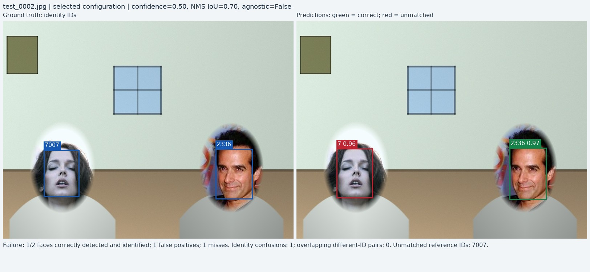
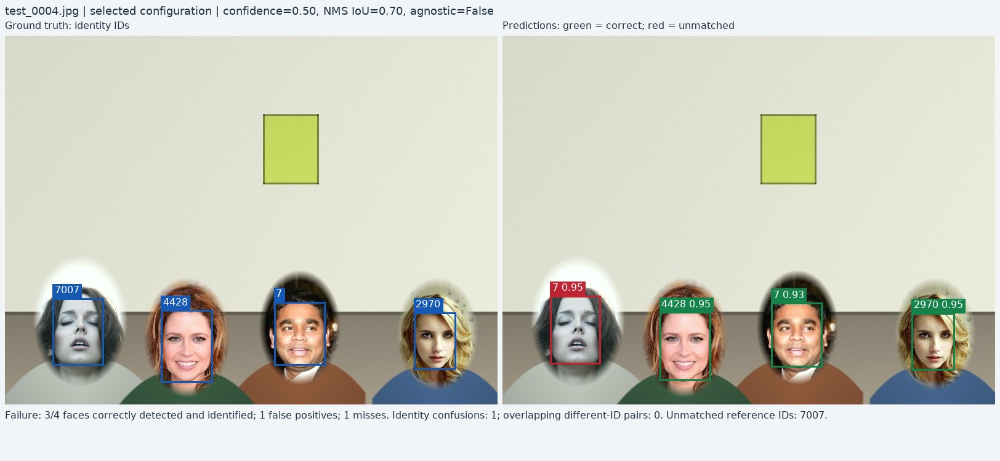
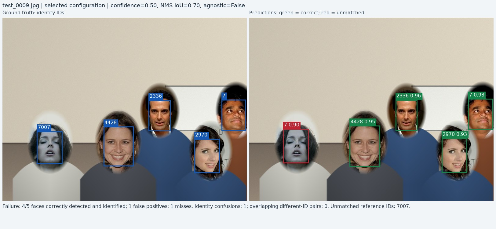
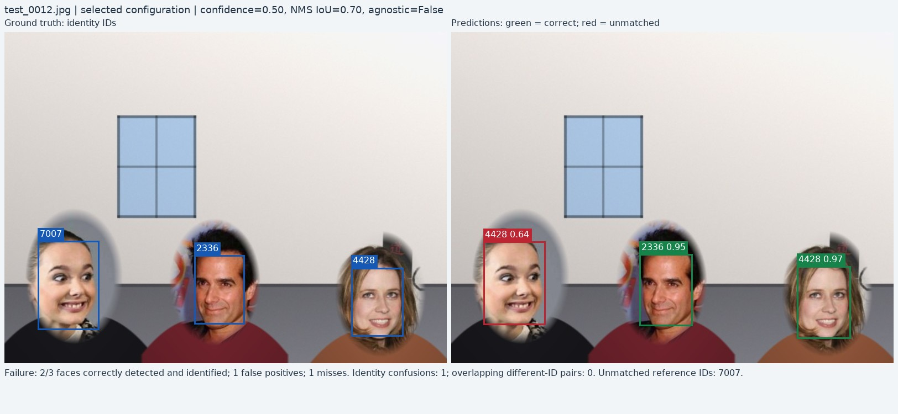
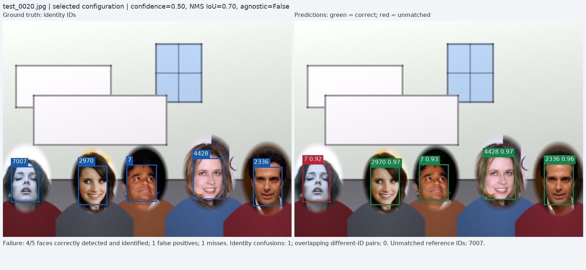
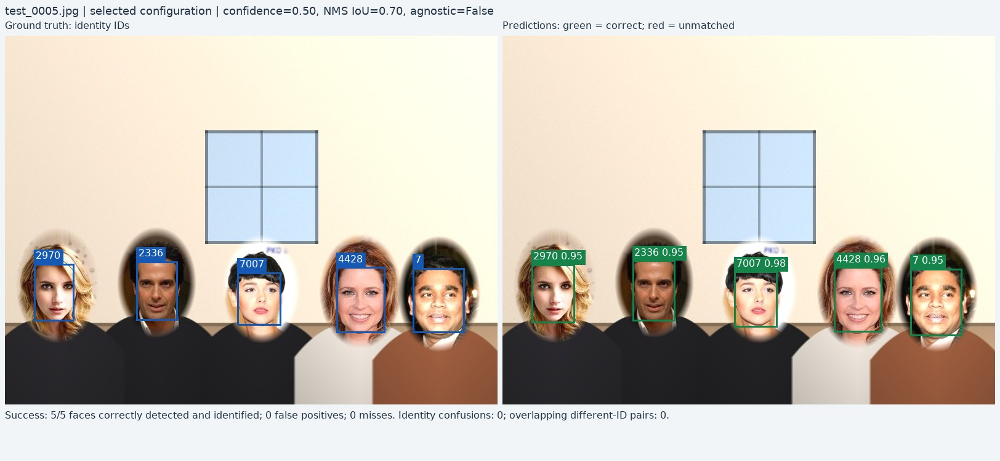
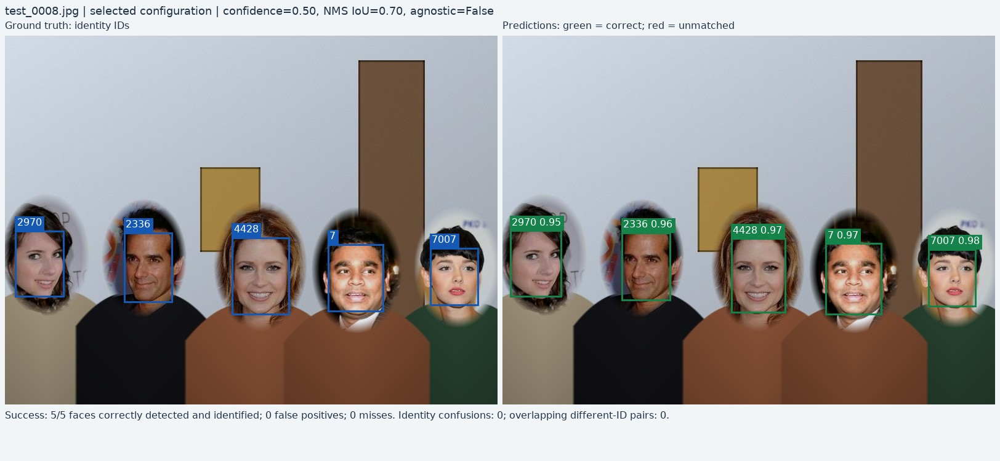
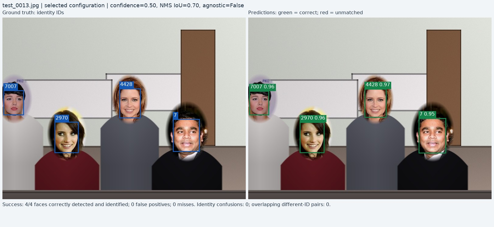
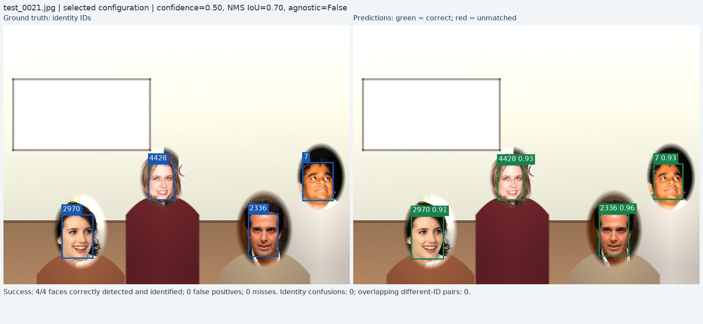
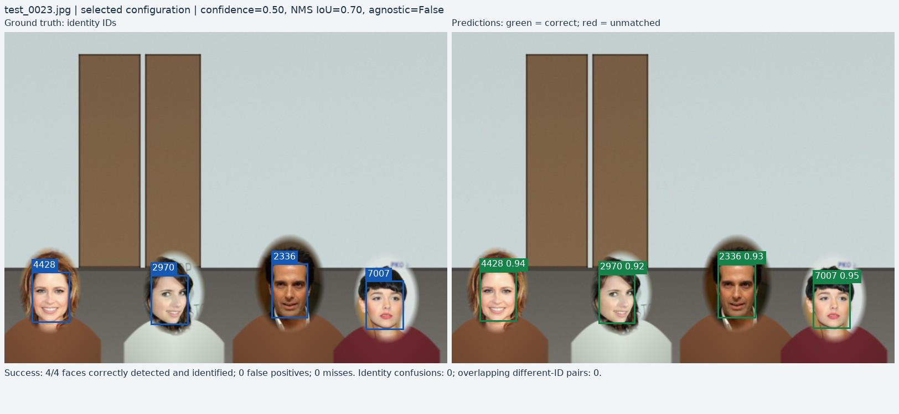

# Detection visualization gallery

Owner: Dario Garza.

All images come from the held-out test split. Selection of the model settings used validation only.

Ground truth appears on the left. Predictions with identity IDs and confidence scores appear on the right. Green predictions match the correct identity at IoU >= 0.50; red predictions are unmatched. A wrong identity contributes both a false positive and a false negative.

Failures from the predeclared baseline may supplement failures from the selected configuration. Each panel names the settings that actually generated its predictions.

## 1. Failure — test_0002.jpg

Settings: selected configuration, `conf_0.50_iou_0.70_aware`.

Failure: 1/2 faces correctly detected and identified; 1 false positives; 1 misses. Identity confusions: 1; overlapping different-ID pairs: 0. Unmatched reference IDs: 7007.

## 2. Failure — test_0004.jpg

Settings: selected configuration, `conf_0.50_iou_0.70_aware`.

Failure: 3/4 faces correctly detected and identified; 1 false positives; 1 misses. Identity confusions: 1; overlapping different-ID pairs: 0. Unmatched reference IDs: 7007.

## 3. Failure — test_0009.jpg

Settings: selected configuration, `conf_0.50_iou_0.70_aware`.

Failure: 4/5 faces correctly detected and identified; 1 false positives; 1 misses. Identity confusions: 1; overlapping different-ID pairs: 0. Unmatched reference IDs: 7007.

## 4. Failure — test_0012.jpg

Settings: selected configuration, `conf_0.50_iou_0.70_aware`.

Failure: 2/3 faces correctly detected and identified; 1 false positives; 1 misses. Identity confusions: 1; overlapping different-ID pairs: 0. Unmatched reference IDs: 7007.

## 5. Failure — test_0020.jpg

Settings: selected configuration, `conf_0.50_iou_0.70_aware`.

Failure: 4/5 faces correctly detected and identified; 1 false positives; 1 misses. Identity confusions: 1; overlapping different-ID pairs: 0. Unmatched reference IDs: 7007.

## 6. Success — test_0005.jpg

Settings: selected configuration, `conf_0.50_iou_0.70_aware`.

Success: 5/5 faces correctly detected and identified; 0 false positives; 0 misses. Identity confusions: 0; overlapping different-ID pairs: 0.

## 7. Success — test_0008.jpg

Settings: selected configuration, `conf_0.50_iou_0.70_aware`.

Success: 5/5 faces correctly detected and identified; 0 false positives; 0 misses. Identity confusions: 0; overlapping different-ID pairs: 0.

## 8. Success — test_0013.jpg

Settings: selected configuration, `conf_0.50_iou_0.70_aware`.

Success: 4/4 faces correctly detected and identified; 0 false positives; 0 misses. Identity confusions: 0; overlapping different-ID pairs: 0.

## 9. Success — test_0021.jpg

Settings: selected configuration, `conf_0.50_iou_0.70_aware`.

Success: 4/4 faces correctly detected and identified; 0 false positives; 0 misses. Identity confusions: 0; overlapping different-ID pairs: 0.

## 10. Success — test_0023.jpg

Settings: selected configuration, `conf_0.50_iou_0.70_aware`.

Success: 4/4 faces correctly detected and identified; 0 false positives; 0 misses. Identity confusions: 0; overlapping different-ID pairs: 0.
