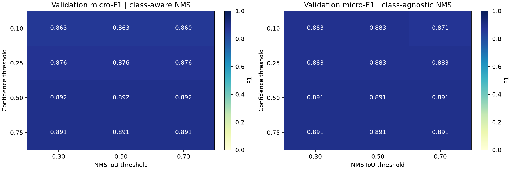

# Milestone 3 — Hyperparameter sweep

Owner: Dario Garza.

## Method

This is an **inference hyperparameter sweep**, using one fixed YOLOv8 checkpoint. It varies confidence and the IoU threshold used by NMS. Both are explicitly allowed by the milestone. Class-aware and class-agnostic NMS are compared as an additional control for overlapping identity predictions. Learning rate, training augmentation and model weights are unchanged.

There are 24 configurations. Validation contains 36 images and 111 faces. The selection rule is maximum validation micro-F1, then recall, precision, mAP@0.5:0.95, class-aware NMS and proximity to baseline. This rule is fixed before test evaluation.

mAP uses a confidence floor of 0.001 and integrates across confidence cutoffs. Precision, recall and F1 use each row's stated confidence. Consequently, mAP is shared by rows with the same NMS settings; changing the reporting threshold alone does not change that AP calculation. The NMS IoU threshold is separate from the fixed IoU >= 0.50 used to match a prediction to a reference box. Mean matched IoU includes correct same-identity matches only and excludes misses and false positives. Matching is one-to-one in descending IoU, consistent with the baseline evaluation script. Ultralytics' automatic max-F1 precision/recall are saved separately in the run metadata.

## Validation comparison

| Configuration | Split | mAP@0.5 | mAP@0.5:0.95 | Precision | Recall | F1 | Mean matched IoU | FP | FN |
|---|---|---:|---:|---:|---:|---:|---:|---:|---:|
| conf_0.10_iou_0.30_aware | val | 0.9721 | 0.8692 | 0.8211 | 0.9099 | 0.8632 | 0.9319 | 22 | 10 |
| conf_0.10_iou_0.30_agnostic | val | 0.8759 | 0.7824 | 0.8829 | 0.8829 | 0.8829 | 0.9314 | 13 | 13 |
| conf_0.10_iou_0.50_aware | val | 0.9721 | 0.8692 | 0.8211 | 0.9099 | 0.8632 | 0.9319 | 22 | 10 |
| conf_0.10_iou_0.50_agnostic | val | 0.8759 | 0.7824 | 0.8829 | 0.8829 | 0.8829 | 0.9314 | 13 | 13 |
| conf_0.10_iou_0.70_aware | val | 0.9721 | 0.8692 | 0.8145 | 0.9099 | 0.8596 | 0.9319 | 23 | 10 |
| conf_0.10_iou_0.70_agnostic | val | 0.8759 | 0.7824 | 0.8596 | 0.8829 | 0.8711 | 0.9314 | 16 | 13 |
| conf_0.25_iou_0.30_aware | val | 0.9721 | 0.8692 | 0.8609 | 0.8919 | 0.8761 | 0.9313 | 16 | 12 |
| conf_0.25_iou_0.30_agnostic | val | 0.8759 | 0.7824 | 0.8829 | 0.8829 | 0.8829 | 0.9314 | 13 | 13 |
| conf_0.25_iou_0.50_aware | val | 0.9721 | 0.8692 | 0.8609 | 0.8919 | 0.8761 | 0.9313 | 16 | 12 |
| conf_0.25_iou_0.50_agnostic | val | 0.8759 | 0.7824 | 0.8829 | 0.8829 | 0.8829 | 0.9314 | 13 | 13 |
| conf_0.25_iou_0.70_aware | val | 0.9721 | 0.8692 | 0.8609 | 0.8919 | 0.8761 | 0.9313 | 16 | 12 |
| conf_0.25_iou_0.70_agnostic | val | 0.8759 | 0.7824 | 0.8829 | 0.8829 | 0.8829 | 0.9314 | 13 | 13 |
| conf_0.50_iou_0.30_aware | val | 0.9721 | 0.8692 | 0.8919 | 0.8919 | 0.8919 | 0.9313 | 12 | 12 |
| conf_0.50_iou_0.30_agnostic | val | 0.8759 | 0.7824 | 0.8991 | 0.8829 | 0.8909 | 0.9314 | 11 | 13 |
| conf_0.50_iou_0.50_aware | val | 0.9721 | 0.8692 | 0.8919 | 0.8919 | 0.8919 | 0.9313 | 12 | 12 |
| conf_0.50_iou_0.50_agnostic | val | 0.8759 | 0.7824 | 0.8991 | 0.8829 | 0.8909 | 0.9314 | 11 | 13 |
| conf_0.50_iou_0.70_aware | val | 0.9721 | 0.8692 | 0.8919 | 0.8919 | 0.8919 | 0.9313 | 12 | 12 |
| conf_0.50_iou_0.70_agnostic | val | 0.8759 | 0.7824 | 0.8991 | 0.8829 | 0.8909 | 0.9314 | 11 | 13 |
| conf_0.75_iou_0.30_aware | val | 0.9721 | 0.8692 | 0.8991 | 0.8829 | 0.8909 | 0.9314 | 11 | 13 |
| conf_0.75_iou_0.30_agnostic | val | 0.8759 | 0.7824 | 0.8991 | 0.8829 | 0.8909 | 0.9314 | 11 | 13 |
| conf_0.75_iou_0.50_aware | val | 0.9721 | 0.8692 | 0.8991 | 0.8829 | 0.8909 | 0.9314 | 11 | 13 |
| conf_0.75_iou_0.50_agnostic | val | 0.8759 | 0.7824 | 0.8991 | 0.8829 | 0.8909 | 0.9314 | 11 | 13 |
| conf_0.75_iou_0.70_aware | val | 0.9721 | 0.8692 | 0.8991 | 0.8829 | 0.8909 | 0.9314 | 11 | 13 |
| conf_0.75_iou_0.70_agnostic | val | 0.8759 | 0.7824 | 0.8991 | 0.8829 | 0.8909 | 0.9314 | 11 | 13 |

## Selected settings and interpretation

Selected: **conf_0.50_iou_0.70_aware**. Validation F1 changes from 0.8761 to 0.8919 (+0.0158) against the predeclared baseline. Validation false positives change from 16 to 12; false negatives change from 12 to 12. Higher confidence removes weak predictions but can miss faces. Lower NMS IoU suppresses boxes more aggressively. Class-agnostic NMS can remove different-identity duplicates, but it can also suppress a real nearby face.

## Held-out test check

| Configuration | Split | mAP@0.5 | mAP@0.5:0.95 | Precision | Recall | F1 | Mean matched IoU | FP | FN |
|---|---|---:|---:|---:|---:|---:|---:|---:|---:|
| conf_0.25_iou_0.70_aware | test | 0.9623 | 0.8623 | 0.8983 | 0.9381 | 0.9177 | 0.9314 | 12 | 7 |
| conf_0.50_iou_0.70_aware | test | 0.9623 | 0.8623 | 0.9286 | 0.9204 | 0.9244 | 0.9325 | 8 | 9 |

The baseline and selected configuration were the only predeclared test comparisons. Test results were not used to revise settings. Gallery images were curated after that choice. These synthetic scenes reuse a small source-photo pool; the results do not establish accuracy on real group photos.

## Gallery and handoff

See [the annotated gallery](gallery/README.md) for at least ten unique multi-face examples and captions. Use `validation_sweep.csv`, `test_metrics.csv`, `per_class_metrics.csv`, `selected_config.json` and this summary in the team's detection-results document. There are no new training loss curves because this sweep does not retrain the model.

## Reproduction

Checkpoint SHA-256: `64f5686b5a7760fee18cf215b1e29f4aa5af95dc90fbf0b571635ed08aa1d2e6`.

Dataset SHA-256: `2b31b489a30f70d1a0f24f75e87641ee137774c87f6c335362c7e6142a99b782`.

The exact arguments, environment and input provenance are saved in `run_summary.json`. Low-confidence predictions are retained under `raw_predictions/` so threshold scores can be audited.

References: [Ultralytics validation](https://docs.ultralytics.com/modes/val/) and [Ultralytics prediction/NMS settings](https://docs.ultralytics.com/modes/predict/).
