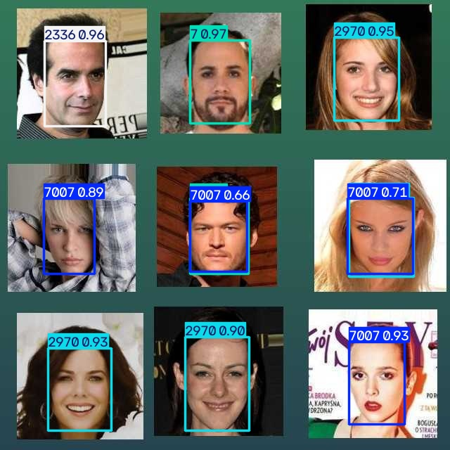

# TA image check - unknown faces and real photos

The teaching staff asked us to test the model on a 3×3 grid of real celebrity photos ([`ta_test_image.png`](ta_test_image.png)). No identity labels or boxes came with it, so this is not a scored test. It probes two things our synthetic test split cannot:

- **Unknown people.** The model has exactly five classes and no "unknown" output. Faces of anyone else must either be missed or be given one of the five IDs.
- **Real photos.** Large, tightly cropped portraits in a grid look nothing like the small pasted faces in our synthetic scenes.

## Result with the selected settings (confidence 0.50, NMS IoU 0.70)



To decide which tiles show our identities, we compared each tile with our 121 source photos. Three tiles are copies of photos in our **training** split; we found no match for the other six, and they do not resemble our reference photos.

| Tile | In our source photos? | Predicted ID (confidence) | Verdict |
| --- | --- | --- | --- |
| Top left | Yes: `2336/165685.jpg`, train | 2336 (0.96) | Correct |
| Top middle | No | 7 (0.97) | Unknown face given an ID |
| Top right | Yes: `2970/059300.jpg`, train | 2970 (0.95) | Correct |
| Middle left | No | 7007 (0.89) | Unknown face given an ID |
| Middle centre | No | 7007 (0.66) and 7 (0.60), overlapping | Unknown face, two IDs |
| Middle right | No | 7007 (0.71) and 2970 (0.70), overlapping | Unknown face, two IDs |
| Bottom left | No | 2970 (0.93) | Unknown face given an ID |
| Bottom middle | No | 2970 (0.90) | Unknown face given an ID |
| Bottom right | Yes: `7007/099068.jpg`, train | 7007 (0.93) | Correct |

**Localization works:** all nine faces got a box. **Identification does not generalize:** the three correct identities are photos the model was trained on, so they show memorization, not recognition. All six unknown faces received a celebrity ID, and the most confident box in the image (0.97) belongs to an unknown face.

## Why threshold tuning cannot fix this

Correct boxes score 0.93–0.96, but boxes on unknown faces score 0.60–0.97. No confidence threshold separates them. A cutoff of 0.95 would still keep the top-middle unknown face and would drop the correct 7007 box. The baseline (confidence 0.25) gives the same 11 boxes. Class-agnostic NMS ([`ta_agnostic.jpg`](ta_agnostic.jpg)) removes the two duplicate boxes, leaving one box per face, but does not change the wrong identities.

The detector reports how confident it is that a face belongs to one of the five classes. It cannot report that a face belongs to none of them. For Milestone 4 the pipeline needs a rejection step, for example using YOLO for face boxes and a separate check that can answer "not one of the five" (classifier probability or embedding-distance threshold). Wrongly naming a stranger is the most harmful error for a face-identification system, which is relevant to the ethical reflection.

## Reproduce

```sh
python project_milestone03/demo.py --image project_milestone03/results/ta_image_check/ta_test_image.png --output tmp/demo/ta_selected.jpg
python project_milestone03/demo.py --image project_milestone03/results/ta_image_check/ta_test_image.png --agnostic-nms --output tmp/demo/ta_agnostic.jpg
```

The image here is a 640×640 PNG copy of the TA's `testimage.jpeg`. It gives the same 11 boxes and IDs as the original, which `results/metrics.json` records; confidences differ by up to 0.02 (for example 0.60 here and 0.58 on the original for the middle-centre 7 box). The results report quotes the original's values.
