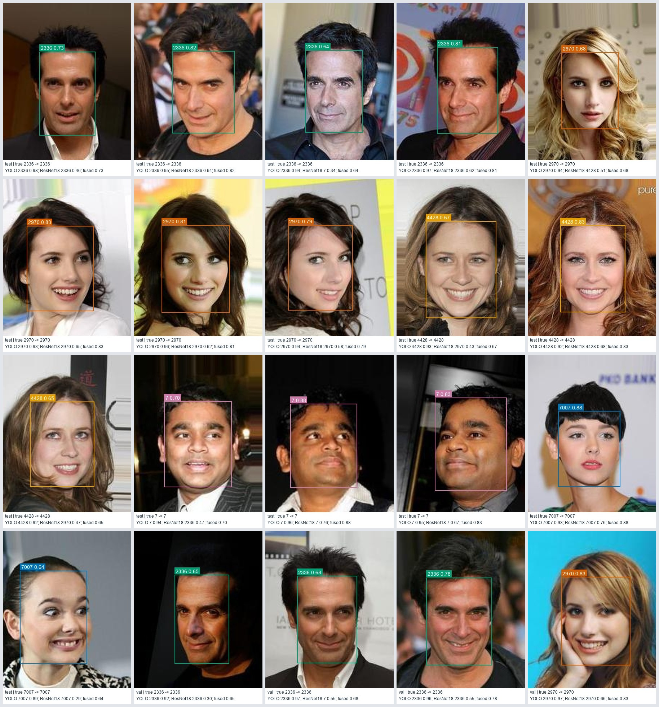
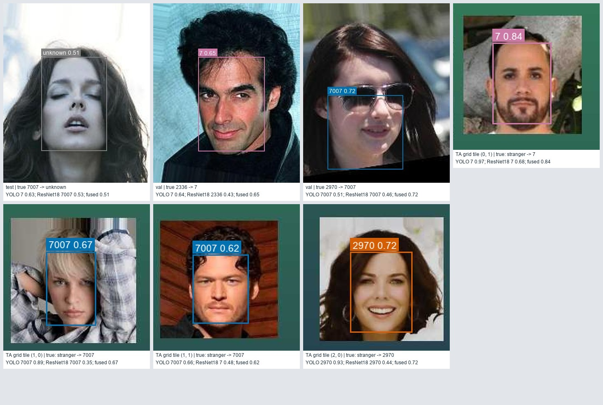
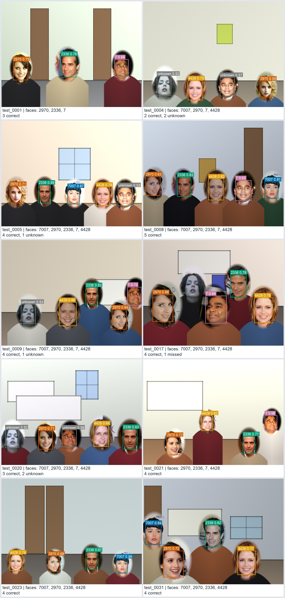

# Milestone 4 results gallery

Built by [`gallery.py`](../gallery.py) from the end-to-end pipeline's saved predictions ([`results/predictions.csv`](../results/predictions.csv)). Each label shows the pipeline's answer and fused confidence; captions also give each model's own answer. Grey boxes are faces the pipeline found but did not name, because the fused confidence was below the validated threshold of 0.61.

Portraits are the held-out source photos (178 × 218) shown at twice their size. Test photos come first; validation photos were used only to choose the pipeline settings, never for training.

## 20 correctly identified single faces

| File | Split | Identity | Model opinions |
| --- | --- | --- | --- |
| [01_test_2336_164485.jpg](single_correct/01_test_2336_164485.jpg) | test | 2336 | YOLO 2336 0.98; ResNet18 2336 0.46; fused 0.73 |
| [02_test_2336_167141.jpg](single_correct/02_test_2336_167141.jpg) | test | 2336 | YOLO 2336 0.95; ResNet18 2336 0.64; fused 0.82 |
| [03_test_2336_175969.jpg](single_correct/03_test_2336_175969.jpg) | test | 2336 | YOLO 2336 0.94; ResNet18 7 0.34; fused 0.64 |
| [04_test_2336_176863.jpg](single_correct/04_test_2336_176863.jpg) | test | 2336 | YOLO 2336 0.97; ResNet18 2336 0.62; fused 0.81 |
| [05_test_2970_018364.jpg](single_correct/05_test_2970_018364.jpg) | test | 2970 | YOLO 2970 0.94; ResNet18 4428 0.51; fused 0.68 |
| [06_test_2970_112624.jpg](single_correct/06_test_2970_112624.jpg) | test | 2970 | YOLO 2970 0.93; ResNet18 2970 0.65; fused 0.83 |
| [07_test_2970_126467.jpg](single_correct/07_test_2970_126467.jpg) | test | 2970 | YOLO 2970 0.96; ResNet18 2970 0.62; fused 0.81 |
| [08_test_2970_136196.jpg](single_correct/08_test_2970_136196.jpg) | test | 2970 | YOLO 2970 0.94; ResNet18 2970 0.58; fused 0.79 |
| [09_test_4428_012582.jpg](single_correct/09_test_4428_012582.jpg) | test | 4428 | YOLO 4428 0.93; ResNet18 2970 0.43; fused 0.67 |
| [10_test_4428_072601.jpg](single_correct/10_test_4428_072601.jpg) | test | 4428 | YOLO 4428 0.92; ResNet18 4428 0.68; fused 0.83 |
| [11_test_4428_092565.jpg](single_correct/11_test_4428_092565.jpg) | test | 4428 | YOLO 4428 0.92; ResNet18 2970 0.47; fused 0.65 |
| [12_test_7_036895.jpg](single_correct/12_test_7_036895.jpg) | test | 7 | YOLO 7 0.94; ResNet18 2336 0.47; fused 0.70 |
| [13_test_7_090940.jpg](single_correct/13_test_7_090940.jpg) | test | 7 | YOLO 7 0.96; ResNet18 7 0.76; fused 0.88 |
| [14_test_7_115977.jpg](single_correct/14_test_7_115977.jpg) | test | 7 | YOLO 7 0.95; ResNet18 7 0.67; fused 0.83 |
| [15_test_7007_004680.jpg](single_correct/15_test_7007_004680.jpg) | test | 7007 | YOLO 7007 0.93; ResNet18 7007 0.76; fused 0.88 |
| [16_test_7007_128347.jpg](single_correct/16_test_7007_128347.jpg) | test | 7007 | YOLO 7007 0.89; ResNet18 7007 0.29; fused 0.64 |
| [17_val_2336_170253.jpg](single_correct/17_val_2336_170253.jpg) | val | 2336 | YOLO 2336 0.92; ResNet18 2336 0.30; fused 0.65 |
| [18_val_2336_172502.jpg](single_correct/18_val_2336_172502.jpg) | val | 2336 | YOLO 2336 0.97; ResNet18 7 0.55; fused 0.68 |
| [19_val_2336_176926.jpg](single_correct/19_val_2336_176926.jpg) | val | 2336 | YOLO 2336 0.96; ResNet18 2336 0.55; fused 0.78 |
| [20_val_2970_014435.jpg](single_correct/20_val_2970_014435.jpg) | val | 2970 | YOLO 2970 0.97; ResNet18 2970 0.66; fused 0.83 |

## 7 single-face errors with analysis

Portraits the pipeline named wrongly or withheld, and faces of people outside our five identities (TA real-photo grid) that still received a celebrity name.

| File | Source | Truth | Pipeline | Model opinions | Analysis |
| --- | --- | --- | --- | --- | --- |
| [21_test_7007_150463.jpg](single_misclassified/21_test_7007_150463.jpg) | test | 7007 | unknown | YOLO 7 0.63; ResNet18 7007 0.53; fused 0.51 | Withheld: only ResNet18 chose 7007; the disagreement lowered the fused confidence to 0.510, below the 0.61 threshold. |
| [22_val_2336_173519.jpg](single_misclassified/22_val_2336_173519.jpg) | val | 2336 | 7 | YOLO 7 0.64; ResNet18 2336 0.43; fused 0.65 | The models disagreed (YOLO 7, ResNet18 2336); the averaged scores still favoured 7 above the threshold. |
| [23_val_2970_085698.jpg](single_misclassified/23_val_2970_085698.jpg) | val | 2970 | 7007 | YOLO 7007 0.51; ResNet18 7007 0.46; fused 0.72 | Localization failure: the detector's box covers little of the face (IoU 0.41 with the aligned face position), so both models judged the wrong region and the answer is unreliable. |
| [ta_tile_r0c1.jpg](single_misclassified/ta_tile_r0c1.jpg) | TA image | stranger | 7 | YOLO 7 0.97; ResNet18 7 0.68; fused 0.84 | Stranger named 7: both models agreed, so the fused confidence stayed above the threshold. A closed-set model has no way to say 'none of the five'. |
| [ta_tile_r1c0.jpg](single_misclassified/ta_tile_r1c0.jpg) | TA image | stranger | 7007 | YOLO 7007 0.89; ResNet18 7007 0.35; fused 0.67 | Stranger named 7007: both models agreed, so the fused confidence stayed above the threshold. A closed-set model has no way to say 'none of the five'. |
| [ta_tile_r1c1.jpg](single_misclassified/ta_tile_r1c1.jpg) | TA image | stranger | 7007 | YOLO 7007 0.66; ResNet18 7 0.48; fused 0.62 | Stranger named 7007: YOLO's confident score (0.66) carried the fused confidence over the threshold although ResNet18 disagreed. |
| [ta_tile_r2c0.jpg](single_misclassified/ta_tile_r2c0.jpg) | TA image | stranger | 2970 | YOLO 2970 0.93; ResNet18 2970 0.44; fused 0.72 | Stranger named 2970: both models agreed, so the fused confidence stayed above the threshold. A closed-set model has no way to say 'none of the five'. |

## 10 multi-face test scenes

Held-out test scenes (800 × 600). Five have every face named correctly; five include at least one face that was withheld or missed.

| File | Faces (reference) | Result | Notes |
| --- | --- | --- | --- |
| [test_0001.jpg](multi_face/test_0001.jpg) | 2970, 2336, 7 | 3 correct |  |
| [test_0004.jpg](multi_face/test_0004.jpg) | 7007, 2970, 7, 4428 | 2 correct, 2 unknown | 7 withheld (YOLO 7, ResNet18 2336, fused 0.57); 7007 withheld (YOLO 7, ResNet18 7007, fused 0.52) |
| [test_0005.jpg](multi_face/test_0005.jpg) | 7007, 2970, 2336, 7, 4428 | 4 correct, 1 unknown | 7 withheld (YOLO 7, ResNet18 2336, fused 0.53) |
| [test_0008.jpg](multi_face/test_0008.jpg) | 7007, 2970, 2336, 7, 4428 | 5 correct |  |
| [test_0009.jpg](multi_face/test_0009.jpg) | 7007, 2970, 2336, 7, 4428 | 4 correct, 1 unknown | 7007 withheld (YOLO 7, ResNet18 7007, fused 0.53) |
| [test_0017.jpg](multi_face/test_0017.jpg) | 7007, 2970, 2336, 7, 4428 | 4 correct, 1 missed |  |
| [test_0020.jpg](multi_face/test_0020.jpg) | 7007, 2970, 2336, 7, 4428 | 3 correct, 2 unknown | 7007 withheld (YOLO 7, ResNet18 7007, fused 0.52); 7 withheld (YOLO 7, ResNet18 2336, fused 0.59) |
| [test_0021.jpg](multi_face/test_0021.jpg) | 2970, 2336, 7, 4428 | 4 correct |  |
| [test_0023.jpg](multi_face/test_0023.jpg) | 7007, 2970, 2336, 4428 | 4 correct |  |
| [test_0031.jpg](multi_face/test_0031.jpg) | 7007, 2970, 2336, 4428 | 4 correct |  |

Rebuild: `python project_milestone04/evaluate.py` then `python project_milestone04/gallery.py`.
